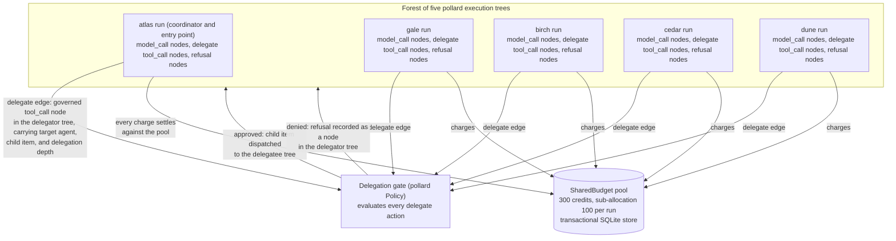
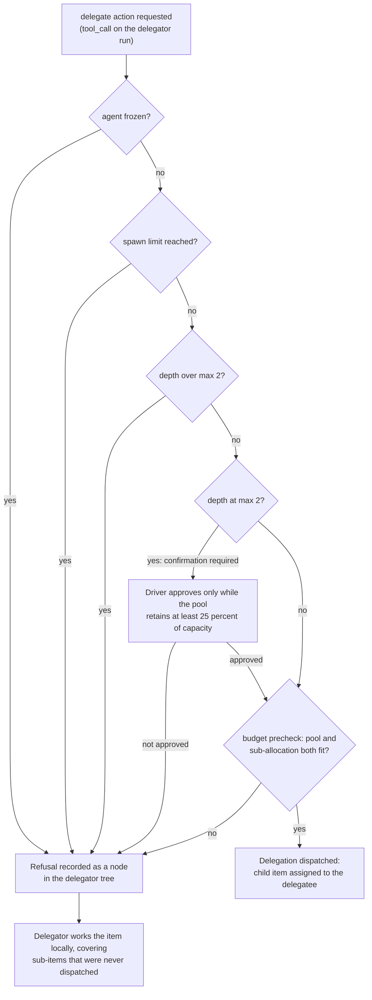
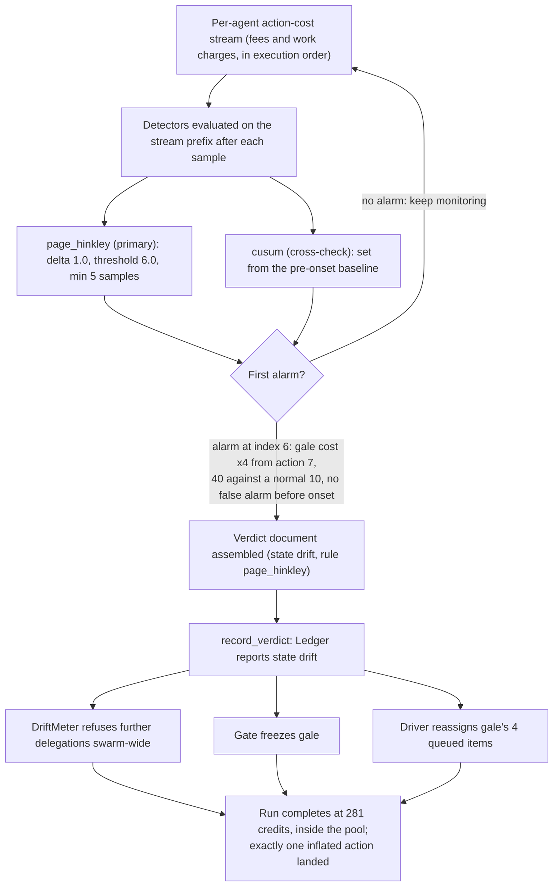

# swarm-forest
Video walkthrough (4 min, narrated): https://youtu.be/6ashWBPD0LM

**Alignment Does Not Compose: Governed Execution Forests for Agent Swarms.**

An experiment built on two published packages, [pollard](https://pypi.org/project/pollard/) (governed semantic execution trees for framework-independent AI agent control and replay) and [epicormic](https://pypi.org/project/epicormic/) (provider drift detection and containment for pollard-governed systems). Both packages are preexisting work, published before this sprint and used unmodified; the swarm layer in this repository is the sprint's work.

Thesis: per-agent governance does not compose to swarm-level safety. Each agent in the swarm runs as an individually governed pollard execution tree, yet the swarm still fails collectively through a delegation cascade that no single agent's budget or policy can see. The fix is also at the execution layer: treat the swarm as a forest, make every delegation edge a governed action in the delegator's tree, account against one shared budget pool, and watch swarm telemetry with a sequential drift layer that can freeze a drifting agent and close the delegation gate swarm-wide.

The forest construction:



The delegation gate that every `delegate` action passes through:



## Layout

- `src/swarm_forest/scenario.py`: the deterministic task economy and all parameters.
- `src/swarm_forest/swarm.py`: the driver: per-agent pollard runs, delegation edges, the three conditions, replay.
- `src/swarm_forest/gates.py`: the delegation gate (pollard Policy): depth limit, spawn limit, freeze list, confirmation at the depth boundary.
- `src/swarm_forest/meters.py`: CreditMeter, a pollard meter pricing work and delegation in credits.
- `src/swarm_forest/drift.py`: the drift layer: epicormic Page-Hinkley and CUSUM detectors over a per-agent action-cost stream, verdict recording through the epicormic ledger.
- `src/swarm_forest/recorder.py`: the forest recorder: canonical trace of decisions and edges, SHA-256 digest.
- `src/swarm_forest/runner.py`: CLI that runs all three conditions plus replay and writes results.
- `tests/`: pytest suite: pool accounting, depth gate enforcement, replay equality, drift alarm timing, the three-condition contrast.
- `WRITEUP.md`: the research write-up.
- `results/`: `results.json` (full record), `results.md` (table), and one SQLite pollard store per condition holding the recorded forests.

## Run

```bash
python -m venv .venv
.venv/bin/pip install -e . pytest
.venv/bin/python -m swarm_forest.runner --out results
.venv/bin/python -m pytest
```

Versions used: pollard 1.6.2, epicormic 0.2.0, Python 3.12. Agents are deterministic and seeded; there are no LLM API calls, which is what makes the replay check exact.

## Headline results

Same swarm (5 agents), same parameters, three conditions:

| Metric | Ungoverned | Governed | Governed + drift |
| --- | --- | --- | --- |
| Total spend (credits) | 651 | 251 | 281 |
| Pool (credits) | 300 | 300 | 300 |
| Max delegation depth | 4 | 2 | 2 |
| Task success (complete and within pool) | no | yes | yes |
| Replay trace hash match | yes | yes | yes |

In the drift condition, one agent's work cost quadruples after its fifth executed action. The Page-Hinkley detector alarms on the first inflated action (detection delay 0 stream steps, no false alarm on the pre-onset prefix), the verdict is recorded in the epicormic ledger, the agent is frozen, and a post-verdict delegation probe is refused by epicormic's DriftMeter. Full numbers in `results/results.md` and `results/results.json`.

The drift layer:


